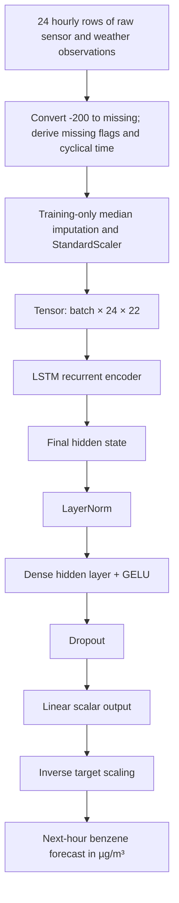

# ANN architecture and design rationale

## Input/output contract

- Input tensor: `(batch_size, 24, 22)`.
- Sequence length: 24 consecutive hourly readings before the prediction timestamp.
- Each time step contains 22 standardised values:
  - 8 sensor/weather measurements: `PT08.S1(CO)`, `PT08.S2(NMHC)`, `PT08.S3(NOx)`, `PT08.S4(NO2)`, `PT08.S5(O3)`, `T`, `RH`, `AH`.
  - 8 missingness indicators, one per measurement.
  - 6 cyclical calendar encodings: hour sin/cos, weekday sin/cos and day-of-year sin/cos.
- Excluded from the input: `CO(GT)`, `NMHC(GT)`, `C6H6(GT)`, `NOx(GT)`, `NO2(GT)` reference-analyser fields.
- Output: one unconstrained linear scalar, inverse-transformed to the next-hour `C6H6(GT)` estimate in µg/m³.

## Diagram

## Layer design

| Component | Input/output | Activation / operation | Rationale |
|---|---|---|---|
| LSTM | `(B, 24, 22)` → `(B, 24, H)` | Recurrent gated state updates | Captures short temporal patterns across the 24-hour sensor history. |
| Final-step selection | `(B, 24, H)` → `(B, H)` | Last output vector | The forecast is made at the end of the observed input window. |
| LayerNorm | `(B, H)` → `(B, H)` | Normalisation | Stabilises hidden activations across batches. |
| Dense hidden | `H` → `max(16, H/2)` | GELU | Learns nonlinear combinations of the encoded temporal state. |
| Dropout | hidden → hidden | Dropout(p) | Regularisation against overfitting on a modest single-site dataset. |
| Output | hidden → 1 | Linear | Regression output may be any real concentration before inverse scaling. |

## Loss and optimisation

Huber loss is used on the standardised target. It behaves quadratically for small residuals and linearly for large residuals, reducing sensitivity to extreme observations compared with pure squared loss. MAE is still the primary reported evaluation metric in the physical target unit. Gradient clipping at norm 1.0 is used for recurrent stability. Early stopping monitors validation MAE, and no test metric is consulted for checkpoint selection.

## Why not transfer a generic pretrained backbone?

Transfer learning is encouraged when a pretrained backbone matches the data modality and task. This dataset has only one year of measurements from one sensor array, with eight specific input channels, field-specific cross-sensitivity and drift. A generic image/audio/text backbone is not a sensible fit. A time-series foundation model could be a future comparator, but it would need a supported multivariate input interface and the exact same allowed inputs and held-out evaluation. The present LSTM is a task-specific architecture; the project documents this as a limitation, not as an assumption that training from scratch is universally better.

## Hyperparameter plan

- Lookback: 3-hour diagnostic ablation vs 24-hour daily-cycle window.
- Hidden size: 8 (under-capacity diagnostic), 32, 64, 96 and 128.
- Recurrent depth: 1, 2 and 3 layers.
- Dropout: 0.10–0.70.
- Learning rate: 0.0001–0.03.
- Batch size: 64, 128 and 256.
- Optimiser: AdamW vs RMSprop.
- Weight decay: 0.0001 default.

The actual sampled configurations and measured outcomes are logged in `experiments/experiment_log.csv`.
